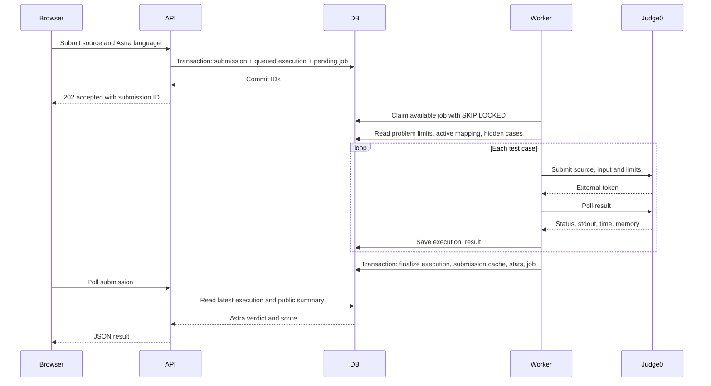

# Astra database

The schema targets MySQL 8.4, InnoDB, `utf8mb4_0900_ai_ci`, and UTC `DATETIME(3)`. [ERD.md](ERD.md) shows keys and cardinalities; `db/migrations/0001_initial_schema.sql` is the exact schema. This is the database layer only. The frontend currently reads browser mock data; API routes, authentication, Judge0 client, and worker remain to be built.

## Existing state and model choice

The backend initially had an empty `db.js` and `server.js`, no schema, migrations, routes, or `.env.example`. The frontend's `js/user-data.js` has per-season rankings (`s04`, `s03`, `all`), submission summaries, badge definitions, and profile activity. Other pages require contest registration, round standings, timed gym runs, public samples, editorials, community solutions, notifications, settings, contact messages, and issue reports.

A contest has rounds; a gym set is a `contest_rounds` row with `type='gym'` and no contest. This shares round problems and timed participation while retaining a `difficulty` and `duration_minutes` for gym filters. Contest format values use the actual frontend filters (`div1`, `div2`, `div3`, `edu`) instead of the generic formats in the earlier spec. Seasonal rankings are date-range queries over `rating_changes` and accepted submissions; season boundaries are API configuration, not a fixed table. All-time solved count comes from `user_problem_stats` or distinct accepted submissions. Country and region are stored on `users`, and friends are `user_follows`.

## Tables

| Domain | Table | Purpose and important fields |
|---|---|---|
| Identity | `users` | Unique case-insensitive handle/email, nullable password hash for OAuth-only users, profile, country/region, role, status, rating. |
| Identity | `oauth_accounts` | Google/Facebook identities linked to users; unique provider identity and one account per provider per user. |
| Identity | `user_settings` | One-to-one theme, default language, source/profile privacy, notification preferences. |
| Identity | `auth_sessions` | Hashed session token, expiry, revocation, user agent, IP. |
| Identity | `password_reset_tokens` | Hashed reset token and use/expiry times. |
| Identity | `email_verification_tokens` | Hashed verification token and use/expiry times. |
| Identity | `user_follows` | Directed friend/follow graph. |
| Problems | `programming_languages` | Astra-visible language names and slugs. |
| Problems | `language_engine_mappings` | Per-engine language key/version and sync time, separate from Astra language identity. |
| Problems | `problems` | Unique slug, Markdown statement, input/output format, source, limits, checker, visibility, author. |
| Problems | `tags`, `problem_tags` | Tag catalog and problem many-to-many link. |
| Problems | `problem_languages` | Optional per-problem allow-list. No rows means all active languages with active engine mappings. |
| Problems | `test_groups` | Optional subtask label, points, and `sum`/`all_or_nothing` mode. |
| Problems | `test_cases` | Input/output, byte sizes, SHA-256 checksum, sample/hidden flags, points, group. |
| Problems | `editorials` | One Markdown editorial per problem and publication time. |
| Contest | `contests` | Slug, format, rated flag, visibility, registration window, creator. |
| Contest | `contest_rounds` | Contest or gym round, schedule, freeze, status, gym difficulty/duration. |
| Contest | `round_problems` | Round problem label, order, points. |
| Contest | `contest_registrations` | One registration per contest/user and its status. |
| Contest | `round_participations` | Timed real/virtual run per user; multiple virtual runs may be recorded. |
| Judge | `submissions` | Immutable source, byte size, submitter, problem/language, optional round/run, cached current status/verdict/score. |
| Judge | `executions` | One initial or rejudge attempt, its status, verdict, score, time, memory, requester. |
| Judge | `execution_results` | One result per execution/test case, external token/status, Astra verdict, capped output, resources, score. |
| Judge | `judge_jobs` | Durable MySQL queue entry, lease, retry count, availability and error summary. |
| Community | `solution_posts`, `solution_votes` | Community Markdown solutions, optional submission link, visibility and one vote per user. |
| Ranking | `rating_changes` | Per-user, per-round rating change, delta and rank. |
| Ranking | `user_problem_stats` | Rebuildable per-user/problem best score, first AC, attempt count. |
| Engagement | `notifications` | Inbox with type, relative link, read time. |
| Engagement | `achievements`, `user_achievements` | Badge definitions and earned instances with evidence links. |
| Support | `contact_messages`, `issue_reports` | Guest or user requests, category, body, triage status. |
| Infrastructure | `schema_migrations` | Runner-managed filename, SHA-256 checksum and application time. |

`v_public_sample_tests` returns public, active problem samples that are not hidden and not attached to an upcoming contest. `v_public_editorials` returns published editorials for public, active problems only after all linked contest rounds end. Public API queries must use these views or equivalent checked service queries. Grant the public API database account read access only to safe views/projections where practical; DB table access alone cannot enforce user identity.

## Profile identity extension (Phase 1)

The backend repo now includes the previously separate `0001_initial_schema.sql` as its baseline migration and `0002_add_oauth_accounts.sql` as the additive identity change. The live Aiven schema could not be inspected from this workspace; compare it with the baseline before applying these files there. Existing `users.user_id`, `handle`, and `country_code` remain the database keys; API responses can expose them as `id`, `username`, and `country`. `password_hash` is nullable only so an OAuth-only user can exist. Service logic must require either a password hash or at least one linked provider and must link by a provider-verified email address.

`oauth_accounts.provider_user_id` uses binary collation for exact provider ID matching. `(provider, provider_user_id)` is unique globally; `(user_id, provider)` limits each user to one account per provider while allowing both Google and Facebook. Deleting a user cascades to its provider links; the existing submission and rating history foreign keys already restrict deletion of users with history.

No new stats table is needed. `users.rating` and `max_rating` hold current and best rating. Submission count comes from `submissions` by `user_id`. Solved count can be derived with `COUNT(DISTINCT problem_id)` over completed accepted submissions, or read from `user_problem_stats` once that cache is maintained by the judging service. The Phase 1 demo seed creates ten fictional public profiles, but it does not fabricate submission or solve history. Its ratings are explicitly illustrative.

## Relationships and invariants

Every foreign key has an index and explicit delete behavior. History (`submissions`, `executions`, `execution_results`, `judge_jobs`, registrations, rating changes) uses `RESTRICT`; deactivate users/problems instead. Pure link rows usually `CASCADE`; nullable author/evidence links use `SET NULL`. `test_cases(problem_id,test_group_id)` references a group of the same problem. `submissions(contest_round_id,round_participation_id)` references a run in the same round. `UNIQUE(execution_id,test_case_id)` prevents double scoring. `UNIQUE(engine,external_token)` prevents accidental token reuse. A submission's current execution is the highest `execution_id` for that submission (`idx_exec_submission`), avoiding a circular foreign key. After a new execution is committed, the worker updates cached submission status/verdict/score in the same transaction that finalizes the execution; readers can also derive them from the latest execution.

A solution's linked submission must be an accepted submission by the same author for the same problem. A service transaction must enforce this; foreign keys alone cannot check it. A round submission's user/problem must match the linked participation and round problem, also enforced by the service. The database allows a problem in multiple rounds; for an upcoming contest, keep it `contest_only` or `hidden` until release. The public views conservatively hide samples/editorials for linked future/unfinished contest rounds even if visibility was set public. The API must apply the same contest gate to the full statement, tags and community solutions.

Test input/output use `MEDIUMTEXT` (16 MiB MySQL limit per field); the API should cap each at a smaller operational limit and the source at 256 KiB. `input_size_bytes`, `output_size_bytes`, and `checksum_sha256` are integrity metadata calculated from UTF-8 bytes by the writer. Large future tests can move to object storage using a new migration; never put object credentials in rows. Per-result `actual_output`, `stderr`, and `compile_output` are capped at 64 KiB each by the worker and `is_output_truncated` records loss. The database column type alone does not enforce that cap. Do not return hidden input/output or per-case output to a public client.

## Statuses and transitions

| Field | Values and transition |
|---|---|
| `users.role` | `user`, `problem_setter`, `admin`; privileged changes require an admin. |
| `users.status` | `unverified` → `active`; `active` ↔ `banned`; no hard deletion with history. |
| `problems.visibility` | `hidden` → `contest_only` → `public`; move back only for moderation. |
| `problems.checker_type` | `exact`, `ignore_trailing_whitespace` (default), `float_tolerance` (requires positive epsilon). |
| `test_groups.scoring_mode` | `sum` sums points; `all_or_nothing` awards its `points` only when all group cases pass. |
| `submissions.status`, `executions.status` | `queued` → `processing` → `completed` or `failed`; a rejudge creates a new execution and resets the submission cache. |
| `verdict` | `AC` accepted, `WA` wrong answer, `TLE` time limit, `MLE` memory limit, `OLE` output limit (reserved), `CE` compile error, `RE` runtime error, `IE` infrastructure/internal error. Null means pending. |
| `judge_jobs.status` | `pending` → `claimed` → `completed`; transient failure returns to `pending` with backoff; after five retries, `failed`. Expired `claimed` lease returns to `pending`. |
| `contests.format` | `div1`, `div2`, `div3`, `edu`, matching frontend filters. |
| `contests.visibility` | `draft`, `public`, `private`; publication is an editorial action. |
| `contest_rounds.type/status` | `contest` or `gym`; `scheduled` → `live` → `finished`, or `cancelled`. Start/end times define actual access window. |
| `contest_registrations.status` | `registered` → `withdrawn` or `disqualified`; a new registration may restore withdrawn. |
| `round_participations.status` | `active` → `finished` or `disqualified`. |
| `solution_posts.visibility` | `public`, `unlisted`, `hidden`; `unlisted` requires a direct link and still follows problem access rules. |
| `notifications.type` | `contest`, `submission`, `achievement`, `system`, `social`. Read state is `read_at IS NULL` or a timestamp. |
| `contact_messages.status`, `issue_reports.status` | `open` → `triaged` → `closed`; a closed report may be reopened by staff. |

These transitions require service checks; ENUM constrains values but cannot enforce state changes.

## Judge0 integration

Judge0 is the MVP engine. DMOJ and CMS are design references only. `language_engine_mappings` stores the instance's actual language ID as a string in `engine_language_key`. The sync script fetches `GET /languages`, prints every returned ID/name, and matches exact names from `config/judge0-language-names.json`; unmatched Astra slugs are skipped. Edit the candidate names to match your running instance, run `--dry-run`, then run without it. No engine IDs are seeded or hardcoded. The worker must refuse a submission when its language lacks an active mapping.

Judge0's commonly documented `/statuses` IDs map in `src/judge/status-map.js` as follows. **Verify these against the configured instance before enabling judging**; no Judge0 URL is configured in this repository.

| Judge0 status | Astra result |
|---|---|
| 1 In Queue, 2 Processing | Pending, no verdict |
| 3 Accepted | `AC` |
| 4 Wrong Answer | `WA` |
| 5 Time Limit Exceeded | `TLE` |
| 6 Compilation Error | `CE` |
| 7–12 Runtime Error variants | `RE` |
| 13 Internal Error, 14 Exec Format Error, unknown | `IE` |

After excluding pending, CE and IE, a measured `memory_kb >= problems.memory_limit_mb × 1024` overrides the status to `MLE`; this is a heuristic because Judge0 has no dedicated MLE status. `OLE` is reserved for a future explicit output-limit policy, not inferred from Judge0. Store `engine_status_id`, description, exit code, time, memory and capped diagnostics for debugging, but never send raw status, tokens or source to unauthorized clients. Judge0 `time` is decimal seconds: multiply by 1000 and round to nearest integer ms. Judge0 `memory` is KB. Null or base64-encoded stdout/stderr/compile output must be decoded safely and size-limited by the eventual worker.

The MVP output checker should send test input to Judge0 without `expected_output`, retrieve stdout, then compare in Astra using the problem's `checker_type` and optional epsilon. The alternative is Judge0's built-in `expected_output` comparison, but it cannot implement all Astra checker modes consistently. Execution limits always come from `problems`, never the request. Neither the checker nor Judge0 API client is implemented yet.



Job claim and lease recovery (each claim uses a transaction; this is an example, not an implemented worker):

```sql
START TRANSACTION;
SELECT job_id FROM judge_jobs
WHERE status = 'pending' AND available_at <= UTC_TIMESTAMP(3)
ORDER BY available_at, job_id LIMIT 1 FOR UPDATE SKIP LOCKED;
UPDATE judge_jobs SET status='claimed', locked_at=UTC_TIMESTAMP(3), locked_by=?
WHERE job_id=?;
COMMIT;
-- Periodic recovery: reclaim locks older than five minutes.
UPDATE judge_jobs SET status='pending', locked_at=NULL, locked_by=NULL,
  retry_count=retry_count+1, available_at=UTC_TIMESTAMP(3)
WHERE status='claimed' AND locked_at < UTC_TIMESTAMP(3) - INTERVAL 5 MINUTE
  AND retry_count < 5;
```

A worker should use exponential backoff for transient failures (`available_at = UTC_TIMESTAMP(3) + INTERVAL ... SECOND`), cap retries at five, and mark permanent failures `failed`. Recovery and retry updates must be coordinated so the same external submission is not judged twice without checking its token. A rejudge adds a new execution and job, preserving old results.

## Visibility and privacy

Public APIs return only active public problems after contest release. Samples come from `v_public_sample_tests`; hidden tests and all per-case private data stay server-side. Editorials come from `v_public_editorials`. Source code is visible to its owner and admins; after a round ends, a public source requires `user_settings.is_source_public=1` and contest rules that permit disclosure. While a round is active, no other participant gets the source. Profile privacy is controlled by `is_profile_public`. Judge0 tokens and raw engine fields never appear in user-facing JSON. Notification links must be relative frontend paths; the API must validate them before insert. Output content needs HTML sanitization at rendering time.

## Initialize and verify

Create an empty local MySQL 8.4 database and user first. Copy `.env.example` to `.env` and set the database values. `DB_HOST=localhost` disables TLS for local development. For Aiven, remote hosts use `certs/ca.pem` by default; set `DB_SSL_CA_PATH` or `DB_SSL_CA` to override it. Never point migration or seed commands at production without explicit authorization.

```bash
npm ci
npm run db:migrate
npm run db:migrate  # should apply 0 files
npm run db:seed
npm run db:smoke
npm run judge0:sync-languages -- --dry-run
npm run judge0:sync-languages
npm start
```

`JUDGE0_URL` is needed only for language sync; `JUDGE0_AUTH_HEADER` and `JUDGE0_AUTH_TOKEN` are optional and must match the instance. The sync script requires Node with built-in `fetch` (Node 18+). Health checks: `GET /api/health` is process readiness and `GET /api/health/db` executes `SELECT 1`. The backend serves JSON only and allows the exact `FRONTEND_ORIGIN` for CORS.

To inspect constraints after migrating:

```sql
SELECT TABLE_NAME, CONSTRAINT_NAME, REFERENCED_TABLE_NAME
FROM information_schema.KEY_COLUMN_USAGE
WHERE TABLE_SCHEMA=DATABASE() AND REFERENCED_TABLE_NAME IS NOT NULL;
SELECT TABLE_NAME, INDEX_NAME, COLUMN_NAME
FROM information_schema.STATISTICS WHERE TABLE_SCHEMA=DATABASE();
```

The migration runner takes an advisory lock, applies ordered SQL files, records SHA-256 checksums, and refuses altered applied files. MySQL DDL commits implicitly; `CREATE TABLE IF NOT EXISTS` lets an interrupted initial migration resume, but inspect any partial failure before retrying. Do not hand-edit an already applied migration. `db:seed` and `db:smoke` refuse `NODE_ENV=production` and are intended for an isolated database.

## Known limits and frontend follow-up

The schema stores or derives the frontend's current fields, except the static docs/FAQ/guide/about content and social links, which remain frontend content. Country names/regions are application metadata around `country_code` and `region`. Profile heatmaps count submissions by user-local calendar day using UTC `submitted_at`; rankings must define season boundaries and scoring formulas. `user_problem_stats`, submission summary fields, `vote_count`, and `users.rating` are caches maintained transactionally by future services, and can be rebuilt from executions, votes and rating changes. Standings are computed from submissions/current executions; no cache table exists yet. Contests with multiple rounds need an explicit registration and scoring policy in the API.

The frontend must replace localStorage mock adapters with authenticated JSON API calls, map its display strings to Astra verdicts/units, and keep its client-side session only for display while the backend enforces authentication. Details belong in the final implementation report. No frontend files are changed here.
