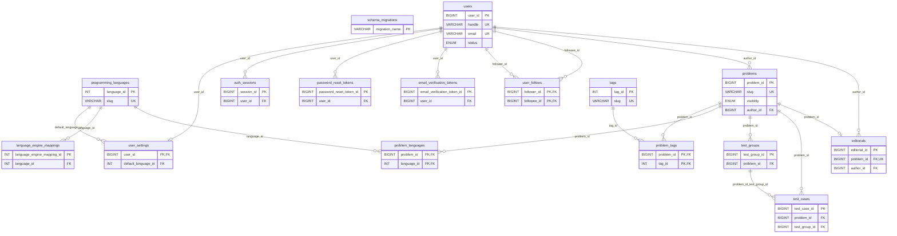
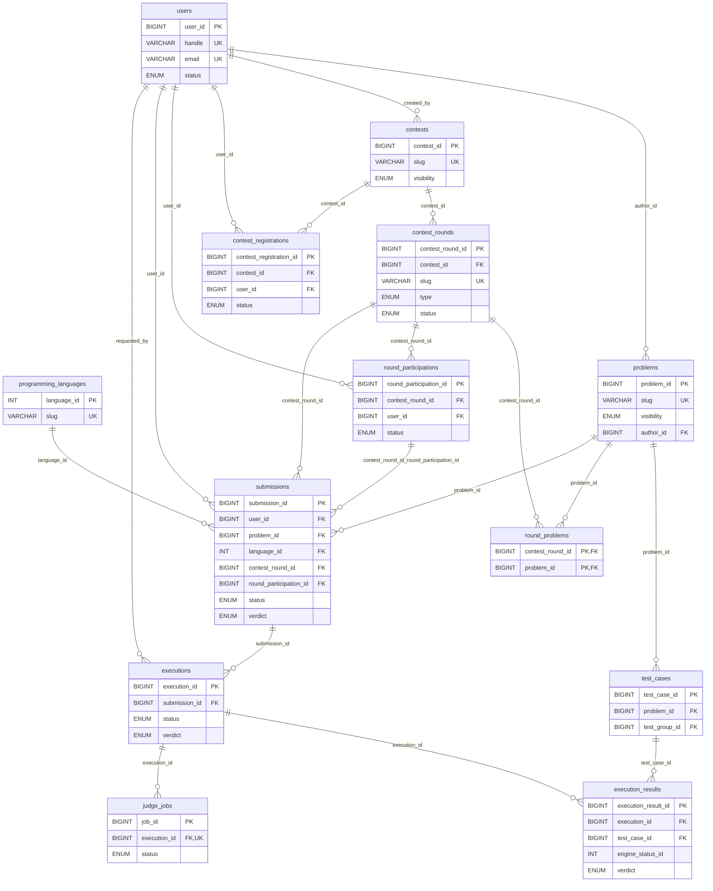
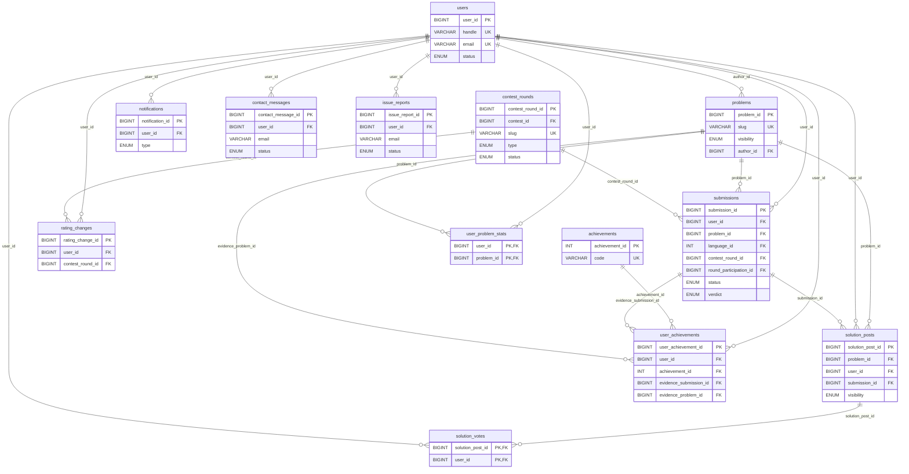

# Astra database ERD

All tables are in the diagrams below. The migration runner also creates `schema_migrations(migration_name PK, checksum_sha256, applied_at)`. Public read views are `v_public_sample_tests` and `v_public_editorials`.

The diagrams show primary and foreign keys; see [DATABASE.md](DATABASE.md) and the migration for all fields and constraints.

## Identity and content

## Contests and judging

## Engagement and support

